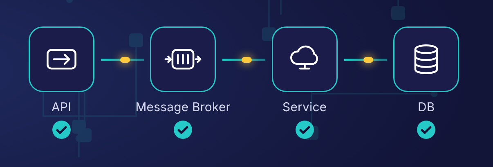

# QALIPSIS

**Validate distributed workflows under load - not just individual endpoints.**

QALIPSIS is an open-source, protocol-level load, performance, and end-to-end testing tool for distributed and asynchronous systems. Write scenarios in a Kotlin DSL, generate concurrent load, and verify outcomes across API calls, messages, database records, and system metrics.

[Run your first test](https://github.com/qalipsis/bootstrap-project#60-second-quickstart) · [Read the documentation](https://qalipsis.io/docs/user-documentation/latest/) · [Browse examples](https://github.com/qalipsis/qalipsis-examples)

## Run your first test

Prerequisite: JDK 11 or later. The Gradle wrapper is included.

```bash
git clone https://github.com/qalipsis/bootstrap-project.git my-load-tests
cd my-load-tests
./gradlew qalipsisRunAllScenarios
```

In under a minute, 10 virtual users ramp up, hit a live HTTP endpoint, and verify every response - your first load test, done. Now make it yours: open `MyBootstrapScenario.kt`, point it at your own API, and run it again.

## What QALIPSIS is built for

- **Workflow verification under load:** check downstream messages, records, and metrics - not only the initial response.
- **Distributed and asynchronous systems:** model multi-step flows across services, brokers, databases, and network protocols.
- **Tests as code:** review and version Kotlin DSL scenarios with the rest of your engineering work.
- **Automation:** run with Gradle, CLI, or REST APIs and use assertions as CI/CD gates.
- **Scale-out execution:** run locally in standalone mode or distribute campaigns across factory nodes and zones.

<p align="center">
  
</p>

## Explore the project

| Repository | Start here when you want to… |
|---|---|
| [bootstrap-project](https://github.com/qalipsis/bootstrap-project) | Run the included scenario and start a test project |
| [qalipsis-oss](https://github.com/qalipsis/qalipsis-oss) | Inspect the core engine |
| [qalipsis-examples](https://github.com/qalipsis/qalipsis-examples) | Find scenarios for HTTP, messaging, databases, and more |
| [qalipsis-plugins](https://github.com/qalipsis/qalipsis-plugins) | Explore open-source integrations |

## Scope

QALIPSIS operates at the protocol level. It tests backend workflows and infrastructure behavior; it does not render browsers or emulate mobile interfaces.

## Open source

[qalipsis-oss](https://github.com/qalipsis/qalipsis-oss#license) uses two licenses, depending on the module:

- **APIs** (`api/` modules, `qalipsis-plugin-platform`, Docker base images): [Apache License 2.0](https://github.com/qalipsis/qalipsis-oss/blob/main/LICENSE-APACHE-2.0). Writing, distributing, and keeping your own scenarios and plugins proprietary only requires these modules.
- **Runtime** (head, factory, runtime, shared, cluster, webapp): dual-licensed under the [AGPL-3.0](https://github.com/qalipsis/qalipsis-oss/blob/main/LICENSE) or a [commercial license](https://github.com/qalipsis/qalipsis-oss/blob/main/LICENSE-COMMERCIAL.md), at your option. Embedding, modifying, or operating these modules without the AGPL obligations requires a commercial license.

Other repositories may use different licenses; check each repository before reuse.

Contributions and technical feedback are welcome. Start with the [contributing guide](https://github.com/qalipsis/qalipsis-oss/blob/main/CONTRIBUTING.md) or open an issue in the relevant repository.
